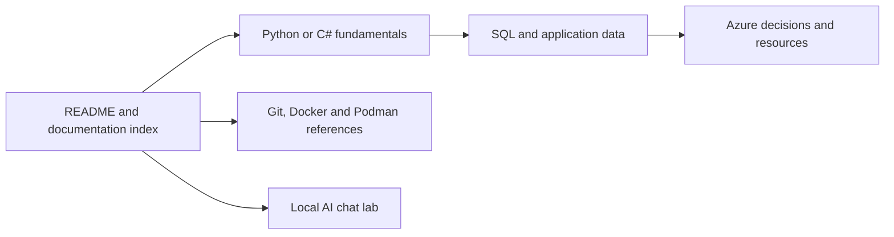

# 📚 Developer Knowledge Base — Python, C#/.NET, SQL and DevOps Guides

Practical Markdown learning paths and references for object-oriented programming, databases, Azure, containers, Git and a local AI chat application.

[](documentation.md)

<a id="build-real-skills-one-practical-guide-at-a-time"></a>

<!-- Preserve links to earlier section headings. -->
<a id="-knowledge-base-learning-paths--python-cnet-sql-azure-docker-podman--git-guides"></a>
<a id="-table-of-contents"></a>
<a id="️-the-complete-study-map"></a>
<a id="-path-1--python-builder-journey"></a>
<a id="-path-2--cnet-builder-journey"></a>
<a id="️-path-3--database-and-sql-journey"></a>
<a id="-path-4--local-ai-builder-journey"></a>
<a id="️-path-5--azure-engineering-journey"></a>
<a id="-before-moving-to-the-next-topic"></a>
<a id="-practice-with-real-code"></a>
<a id="-start-small-stay-curious-build-every-day"></a>
<a id="documentation-links"></a>

## 🔎 Overview

This repository collects authored guides for students, self-learners and developers refreshing their foundations. It contains documentation and sample code within that documentation. Choose one subject and work through its examples in a separate practice folder.

## ✨ Features

- Python and C# courses covering classes, composition, interfaces, testing and design.
- A Python special-method reference and a SQL Server/MySQL course.
- Azure service comparisons and a deeper resource reference.
- Docker, Podman and Git command cheat sheets.
- A Windows lab for an Ollama and Streamlit chat app.
- Reusable AI coding instruction and configuration examples in [`ai-cli/`](ai-cli/).

<a id="quick-start"></a>
<a id="-choose-your-starting-path"></a>

## 🚀 Quick start

Open a guide below or browse the [documentation index](documentation.md). Reading on GitHub requires no installation. To keep an offline copy:

```sh
git clone https://github.com/gcfernando/document.git
cd document
```

Externally hosted images and links to official documentation still need an internet connection.

<a id="-guide-shelf"></a>

| Goal | Start here | Continue with |
|---|---|---|
| Learn Python object-oriented programming | [Python OOP](python_oop_guide.md) | [Python dunder methods](python_dunder.md), then SQL |
| Learn C# and .NET design | [C#/.NET OOP](csharp_dotnet_oop_guide.md) | SQL, then Azure |
| Learn relational databases | [SQL Server and MySQL](sql_complete_guide.md) | A small application using one engine |
| Build a local browser chat app | [Local AI learning lab](local_ai_learning_lab.md) | The lab's verification checkpoint |
| Choose and operate Azure services | [Azure engineering cheat sheet](azure_cheatsheet.md) | [Azure resources reference](azure_resources_cheatsheet.md) |
| Learn container workflows | [Docker](docker_cheatsheet.md) or [Podman](podman_cheatsheet.md) | Images, persistent storage and networking |
| Practise version control | [Git command cheat sheet](git_cheatsheet.md) | Branches and recovery in a disposable repository |

## 📦 Prerequisites and installation

Reading requires a Markdown viewer or browser. Running examples requires the tools named by each guide; there is no repository-wide dependency installer.

| Subject | Preparation |
|---|---|
| Python | Use the guide's Python version and a virtual environment; some special methods require newer versions |
| C#/.NET | Install the SDK required by the selected example; check version-specific syntax |
| SQL | Choose SQL Server or MySQL and create a disposable practice database |
| Containers | Install the relevant runtime and check its local help before using commands |
| Azure | Have an authorized subscription, permissions and a cost plan before provisioning resources |
| Local AI | Follow the Windows/PowerShell, Python and Ollama setup in the lab |

## ⚙️ Configuration

Configuration belongs to each lab. Replace example paths, subscriptions, resource names and credentials with values for your practice environment. AI CLI configuration samples are personal examples: read them and select settings before copying. Instruction files describe behavior; they do not grant permissions or enforce a sandbox.

## 💡 Usage

<a id="-the-learning-loop"></a>

Read one concept, type the example, run it, observe the output and adapt one thing. Keep complete programs together with any preceding declarations they depend on. Fragments, intentional failures and database dialects require the surrounding explanation.

<a id="-your-study-rhythm"></a>

A useful study session is one small example and one note explaining the result. Before moving on, reproduce the example and explain an error or edge case.

## 🏗️ Architecture

<a id="study-map"></a>



The root contains ten subject guides. [`documentation.md`](documentation.md) is the source index; [`ai-cli/`](ai-cli/) contains instruction templates and configuration samples. `_config.yml`, `_layouts/` and `assets/` provide the Jekyll site's presentation. No application source tree or repository-wide test suite is included.

## 🧪 Development and testing

Verify relative links, heading anchors, code-fence boundaries and the applicable command reference when editing. Run changed examples in the environment they require. Some guides record earlier example checks and their toolchains; those records do not establish that every example was rerun on your machine or on every supported version.

## 🛠️ Troubleshooting and limitations

| Problem | Next step |
|---|---|
| A snippet fails with an undefined name | Check whether it continues an earlier example or is a fragment |
| SQL syntax fails | Confirm the engine and version; keep T-SQL and MySQL blocks separate |
| A CLI flag is unavailable | Compare the installed version's help with the official reference |
| A model fails to load | Use the local AI lab's diagnostics and check available memory |
| Cloud details differ | Verify current pricing, quotas, regions, runtimes and retirement notices in Microsoft documentation |

Examples may modify data, history, containers or cloud resources. Review each independently; a command catalog is not a script to execute from top to bottom.

## 🤝 Contributing

Suggest a focused correction through the [repository](https://github.com/gcfernando/document). Include the guide and section, tool version, minimal example and expected result. Preserve existing section links and functional instruction-template syntax. Add official sources for version-dependent corrections.

## 🔒 Security

Keep credentials, private data and confidential source out of examples and issue reports. For sensitive findings, use private security reporting if available; otherwise arrange a private channel with the maintainer before sharing details.

## 📄 Support and license

Use [repository issues](https://github.com/gcfernando/document/issues) for reproducible documentation problems. No license file is present in this checkout; do not assume a reuse license from public visibility. Third-party tools and services retain their own terms.

[Read online](https://gcfernando.github.io/document/documentation/) · [Related developer tools](https://github.com/gcfernando/other_codes) · [All developer projects](https://gcfernando.github.io/gcfernando/projects/)
