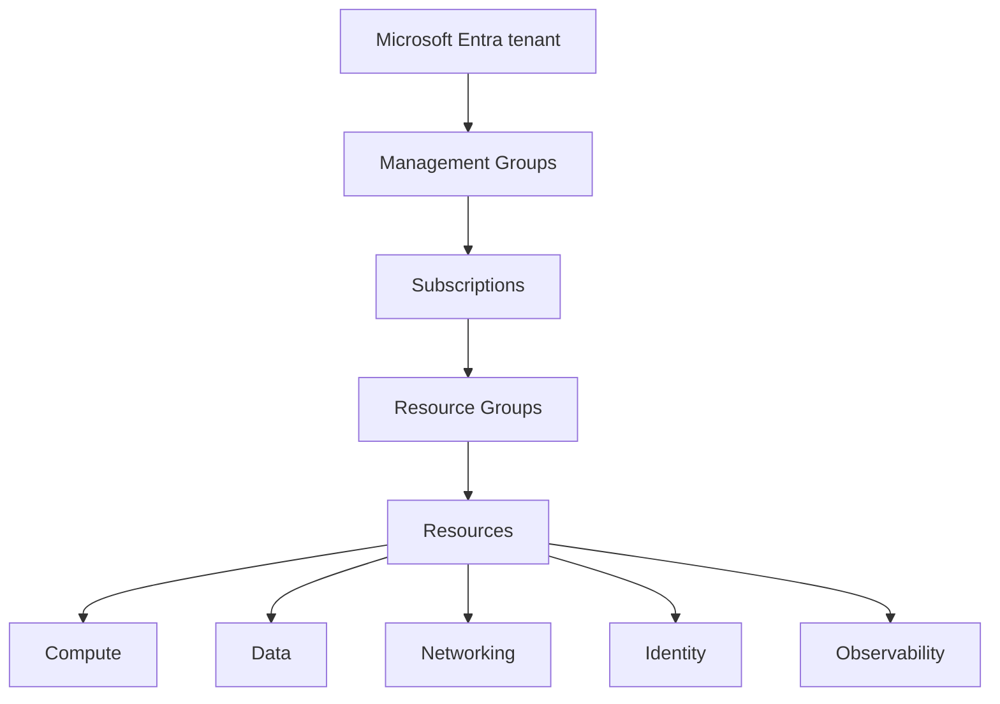
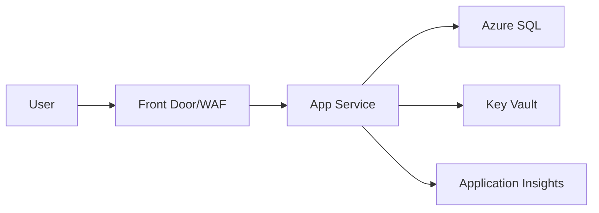

# ☁️ Azure Engineering Cheat Sheet

**🏷️ Difficulty:** 🟢 Beginner introduction → 🔴 Advanced reference (start with the first-time guide below)


> 🌈 **Fast decisions. Fast recall. Production-aware.**  
> **Edition:** 2026-10-03  
> **Purpose:** A true engineering cheat sheet for choosing, connecting, operating, and troubleshooting Azure services quickly.  
> **Deep companion:** [`azure_resources_cheatsheet.md`](./azure_resources_cheatsheet.md)
>
> [!IMPORTANT]
> Always verify **pricing, SKUs, quotas, limits, regional availability, Availability Zone support, SLA, API versions, preview/GA status, runtime support, and retirement dates** in current Microsoft documentation before production use.

---

## 👋 New to Azure? Start here

Azure is Microsoft's cloud platform: instead of installing your own physical server, you create services in a Microsoft data center. **A resource** is one of those services; a **resource group** is a folder-like management container; a **subscription** is the billing and permission boundary. This file is a *reference*, so begin with the first safe steps here before trying a later lab.

1. **Get permission and understand costs.** You need an Azure account with access to a subscription. Viewing resources usually requires Reader permission; creating examples generally requires Contributor or equivalent permissions. **Most created resources can incur charges**, even in short labs. Use a personal, approved test subscription with a budget and delete test resources afterward. Do not experiment in a production (real customer-facing) subscription.
2. **Open a command terminal.** Go to [Azure Portal](https://portal.azure.com/), sign in, open **Cloud Shell** (`>_` icon), and select **Bash**. This is a terminal: a window where you type one instruction (a **command**) at a time. Cloud Shell has Azure CLI (`az`) installed; for your own computer, follow the [Azure CLI installation guide](https://learn.microsoft.com/cli/azure/install-azure-cli). These examples use **Bash, not PowerShell**. Azure Cloud Shell can request one-time storage setup.
3. **Confirm where you are working.** Run the three *read-only* commands below, one at a time. If you have several subscriptions, check the displayed subscription before creating anything.

```bash
az --version
az account show --query "{name:name,id:id}" --output table
az group list --output table
```

**What the commands mean:** `az` invokes Azure CLI; `--version` displays the installed version; `account show` displays the selected subscription; `group list` shows its resource groups. `--query` selects fields and `--output table` makes them easier to read. **Check:** you should see a version and subscription name/ID. An empty resource-group table is possible and is not an error. If `az` is not found, use Bash Cloud Shell or install the CLI; if access is denied, ask your subscription administrator.

**How to read the remaining examples:** Lines beginning with `#` are explanations, not commands. Run commands in order **in the same Bash session**, since later steps can use variables such as `$RG` (a named value). A word in `<angle-brackets>` is a *placeholder*, never literal text to type; replace it with a value from your own account before running. In revised lab commands, variables are assigned actual demonstration names instead. `-g`/`--resource-group` means resource group; `-n`/`--name` means name; `-l`/`--location` means Azure region; `-o`/`--output` controls display; `--sku` chooses a service tier, which can change cost. The `$(...)` syntax inserts the result of a command. `|` passes output to another command. `--yes` skips a delete confirmation, so always inspect the exact resource first. **An example demonstrates syntax; it does not guarantee that your subscription permits or supports that service.**

**Glossary for the diagrams and tables:** **CLI** = command-line interface; **ARM** = Azure Resource Manager (service administration); **RBAC** = role-based access control (who may do what); **VNet** = private virtual network; **NSG** = network security group (network traffic rules); **DNS** = name-to-address lookup; **VM** = virtual machine; **PaaS** = provider-managed hosting; **SKU** = feature/capacity/pricing tier; **IaC** = infrastructure as code (repeatable deployment files); **CI/CD** = automated checks and delivery; **API** = an interface programs use to communicate. You can read a technology decision table without running any commands.

> [!CAUTION]
> **Before any lab:** read its goal, requirements, expected result, and cleanup first. Creating a resource group or service is *not read-only*. Never delete a resource group you did not create for this exercise: deleting it also deletes everything inside it. For commands that refer to existing resources, first discover their names in the Azure Portal or with the relevant `list` command. Flags, availability, quotas, and prices can change; use the linked official reference for your installed version.


## 🎨 Legend

| Symbol | Meaning |
|---|---|
| 🟦 | What it is |
| ✅ | Good default / use when |
| ❌ | Avoid / wrong fit |
| ⚖️ | Compare / choose |
| 🔐 | Identity / security |
| 🌐 | Networking |
| 📈 | Scale / reliability |
| 👀 | Observe / troubleshoot |
| 💰 | Cost |
| 🛠️ | Command / implementation |
| ⚠️ | Common trap |
| 📚 | Official docs |

---

<a id="toc"></a>
## 🗺️ Table of Contents

1. [🧠 Azure Mental Model & Global Infrastructure](#s1)
2. [🏗️ Resource Organization & ARM](#s2)
3. [👤 Identity, Authentication, Authorization & Secrets](#s3)
4. [🌐 Networking & Application Delivery](#s4)
5. [🖥️ Compute, Application Hosting & Containers](#s5)
6. [💾 Storage](#s6)
7. [🗄️ Databases, Caching & Search](#s7)
8. [📨 Messaging, Events, APIs & Integration](#s8)
9. [📊 Observability, Monitoring & Operations](#s9)
10. [🛡️ Security & Threat Protection](#s10)
11. [🧯 Reliability, Availability, Backup & DR](#s11)
12. [🏛️ Governance, Landing Zones & Estate Management](#s12)
13. [💰 Cost Management & FinOps](#s13)
14. [🚀 Developer Tooling, IaC & CI/CD](#s14)
15. [📈 Data & Analytics — Quick Map](#s15)
16. [🤖 AI & Machine Learning — Quick Map](#s16)
17. [🔀 Hybrid, Multicloud, Edge, IoT & Migration](#s17)
18. [⚡ Technology Decision Tables](#s18)
19. [🧩 Architecture Patterns & Reference Topologies](#s19)
20. [⌨️ Operational Quick Reference](#s20)
21. [✅ Production Readiness Checklist](#s21)
22. [🧭 Troubleshooting & Incident Triage](#s22)
23. [🔄 Facts You Must Verify Live](#s23)
24. [📚 Official Microsoft Source Map](#s24)

---

<a id="s1"></a>
## 1. 🧠 Azure Mental Model & Global Infrastructure

### Azure in one picture



#### 🧠 Remember this

```text
Identity decides WHO.
RBAC decides WHAT they may do.
Policy decides WHAT configurations are allowed.
Networking decides HOW traffic moves.
Compute runs CODE.
Storage/databases hold DATA.
Messaging decouples SYSTEMS.
Observability tells you WHAT HAPPENED.
IaC + CI/CD make changes REPEATABLE.
```

### Cloud service models

| Model | You manage most | Azure examples | Default thought |
|---|---|---|---|
| 🧱 **IaaS** | OS + runtime + app | VMs, VMSS | Maximum control, maximum ops |
| 🧰 **PaaS** | App + data/config | App Service, Azure SQL | Prefer when requirements allow |
| ⚡ **Serverless** | Code/config | Functions, Container Apps consumption | Event-driven / elastic |
| ☁️ **SaaS** | Usage/config only | Microsoft 365 | Consume, don't operate |

### Geography / region / zone

- **Geography** → data residency / market grouping.
- **Region** → Azure deployment location such as Sweden Central or West Europe.
- **Availability Zone** → physically separate datacenter zone in a supported region.
- **Zonal** → placed in a chosen zone.
- **Zone-redundant** → service spreads across zones.
- **Global/nonregional** → service control/routing plane isn't tied to one workload region.

> [!WARNING]
> A region having Availability Zones does **not** mean every Azure service or SKU supports zone redundancy there.

### Control plane vs data plane

| Plane | Example | Main auth concept |
|---|---|---|
| 🛠️ Control plane | Create VM, change firewall, assign role | ARM + Azure RBAC |
| 📦 Data plane | Read blob, query SQL, fetch secret | Service-specific data RBAC/auth |

### 🧪 Try it yourself

**Before running:** These commands inspect your subscription or existing resources. Check the active subscription first. If `$RG` or another example name is used, select an existing resource; an empty table can be normal.

**Goal:** Map the picture (tenant → subscription → resource group → resources) onto a real subscription.

```bash
# Example names for this exercise; retain them in this Bash terminal
RG="rg-your-existing-lab"  # Change to a resource group you already have

az account show --query "{subscription:name, tenant:tenantId}" -o table
az group list --query "[].name" -o table
az resource list -g "${RG}" --query "[].{name:name,type:type}" -o table
```

**👀 Expected result:** Your current subscription/tenant, the resource groups inside it, and the resources inside one group.

**✅ Checkpoint:** Can you point at one returned resource and say whether its RBAC role assignment is control-plane or data-plane?

**🧹 Clean up:** Nothing to clean up — read-only commands.

[⬆️ Back to TOC](#toc)

---

<a id="s2"></a>
## 2. 🏗️ Resource Organization & Azure Resource Manager

```text
Tenant
└── Management Group
    └── Subscription
        └── Resource Group
            └── Resource
```

| Object | Think of it as | Common use |
|---|---|---|
| **Tenant** | Identity directory boundary | Users, apps, service principals |
| **Management Group** | Subscription hierarchy | Policy/RBAC inheritance |
| **Subscription** | Billing/quota/deployment boundary | Prod vs non-prod separation |
| **Resource Group** | Lifecycle/ownership grouping | App/environment resources |
| **Resource** | Actual Azure service instance | VM, VNet, SQL DB, Key Vault |

### ARM anatomy

```text
Microsoft.KeyVault/vaults
└── provider ─────┘└type┘
```

```text
/subscriptions/<id>/resourceGroups/<rg>/providers/<provider>/<type>/<name>
```

### Quick rules

- Group resources when they share **ownership + lifecycle + deployment + operations**.
- **Tags** are metadata, not security.
- **Locks** protect against accidental update/delete; they do not replace RBAC.
- Check **resource provider registration** when deployments say a namespace isn't registered.
- Check **quotas before** large deployments, autoscale, or DR tests.

```bash
az account show -o table
az group list -o table
az resource list -g "${RG}" -o table
az provider show --namespace Microsoft.Web --query registrationState -o tsv
```

### 🧪 Try it yourself

**Before running:** This lab creates an isolated test resource group and possibly chargeable services. Check regional availability and access permissions first. Run the setup lines and resource commands together in **Bash**; use the saved `$RG` variable for cleanup. Review the returned details before deletion.

**Goal:** Create and delete a resource group to see the lifecycle/ownership boundary in action.

```bash
az group create -n rg-lab-demo -l swedencentral
az group show -n rg-lab-demo -o table
```

**👀 Expected result:** The resource group is created and shown with `provisioningState: Succeeded`.

**✅ Checkpoint:** What ARM path (`/subscriptions/.../resourceGroups/...`) does this new group live at?

**🧹 Clean up:** `az group delete -n rg-lab-demo --yes`

[⬆️ Back to TOC](#toc)

---

<a id="s3"></a>
## 3. 👤 Identity, Authentication, Authorization & Secrets

### The identity equation

```text
Authentication = Who are you?
Authorization  = What may you do?

Azure RBAC assignment = Principal + Role + Scope
```

#### Core objects

| Object | Purpose |
|---|---|
| User / Group | Human access |
| App Registration | Application identity definition |
| Service Principal | Tenant-local application identity |
| Managed Identity | Azure-managed workload identity |
| Workload Identity Federation | OIDC/federated identity without stored secret |

#### Managed Identity

| Type | Use when |
|---|---|
| **System-assigned** | Identity should die with the resource |
| **User-assigned** | Identity must be reused or lifecycle-independent |

```text
App Service / Function / VM / Container App
                │
                │ Managed Identity
                ▼
     Key Vault / SQL / Storage / Service Bus
```

#### Common RBAC roles

| Role | Meaning |
|---|---|
| Reader | View management-plane resources |
| Contributor | Manage resources, not role assignments |
| Owner | Manage resources + access |
| Storage Blob Data Reader | Read blob data |
| Key Vault Secrets User | Read secrets |
| Service Bus Data Sender/Receiver | Data-plane messaging permissions |

#### 🔐 Good defaults

✅ Managed identity over connection-string secrets.  
✅ OIDC/workload federation for CI/CD.  
✅ Least privilege + smallest practical scope.  
✅ PIM for privileged human access.  
✅ Key Vault for secrets/keys/certificates.

#### ⚠️ Traps

- Correct RBAC does **not** fix blocked networking.
- `Contributor` cannot normally grant roles.
- Management-plane `Owner` does not guarantee every data-plane permission.
- Don't create a client secret just so the app can fetch another secret.

### 🧪 Try it yourself

**Before running:** This exercise creates a new resource in an existing lab resource group and may incur charges. Check the active subscription, regional availability, and permissions. Choose an unused name and delete only the resource created by this exercise.

**Goal:** Create a user-assigned managed identity and inspect its role assignments, then clean up.

```bash
# Example names for this exercise; retain them in this Bash terminal
RG="rg-your-existing-lab"  # Change to a resource group you already have
IDENTITY_NAME="id-learn-r3"

az identity create -g "${RG}" -n "${IDENTITY_NAME}"
PRINCIPAL_ID="$(az identity show -g "${RG}" -n "${IDENTITY_NAME}" --query principalId -o tsv)"
az role assignment list --assignee "${PRINCIPAL_ID}" -o table
```

**👀 Expected result:** The identity is created with its own `principalId`, and the role assignment list is empty until you assign a role.

**✅ Checkpoint:** Why would you use this identity on an App Service instead of storing a connection string with a key?

**🧹 Clean up:** `az identity delete -g "$RG" -n "$IDENTITY_NAME"`

[⬆️ Back to TOC](#toc)

---

<a id="s4"></a>
## 4. 🌐 Networking & Application Delivery

### Network mental model

```text
DNS says WHERE a name points.
Routes say WHERE packets go.
NSG/Firewall says WHETHER packets may pass.
Load balancing says WHICH healthy backend receives traffic.
```

#### Core network resources

| Need | Azure resource |
|---|---|
| Private network | VNet |
| Segment workload | Subnet |
| L3/L4 filter | NSG |
| Custom routing | Route Table / UDR |
| VNet-to-VNet | VNet Peering |
| Private PaaS IP | Private Endpoint / Private Link |
| Stable outbound IP | NAT Gateway |
| Public/private DNS | Azure DNS / Private DNS |
| Hybrid encrypted tunnel | VPN Gateway |
| Private enterprise circuit | ExpressRoute |
| Managed global transit | Virtual WAN |
| Central network firewall | Azure Firewall |
| VM admin without public RDP/SSH | Bastion |

#### Private Endpoint vs Service Endpoint

| | Private Endpoint | Service Endpoint |
|---|---|---|
| Private IP in VNet | ✅ | ❌ |
| Service still has public endpoint | Can disable/restrict | Yes |
| DNS work required | Usually ✅ | Usually simpler |
| Modern production default | Often | Legacy/specific scenarios |

#### Application delivery

| Service | Layer | Scope | Best for |
|---|---:|---|---|
| Load Balancer | L4 | Regional | TCP/UDP |
| Application Gateway | L7 | Regional | HTTP/S, WAF, path/host routing |
| Front Door | L7 | Global edge | Global HTTP/S, WAF, acceleration, failover |
| Traffic Manager | DNS | Global | DNS-based endpoint selection |

> [!TIP]
> **Private Endpoint broken?** Check in this order: `DNS → route → NSG/firewall → endpoint approval/state → RBAC/app auth`.

```bash
nslookup "${HOSTNAME}"
az network nic show-effective-route-table -g "${RG}" -n "${NIC_NAME}"
az network private-endpoint list -g "${RG}" -o table
```

### 🧪 Try it yourself

**Before running:** These commands inspect your subscription or existing resources. Check the active subscription first. If `$RG` or another example name is used, select an existing resource; an empty table can be normal.

**Goal:** Walk the Private Endpoint troubleshooting order end-to-end on a real VNet/subnet.

```bash
# Example names for this exercise; retain them in this Bash terminal
RG="rg-your-existing-lab"  # Change to a resource group you already have
NSG_NAME="demo-nsg"

az network vnet list -g "${RG}" -o table
az network nsg rule list -g "${RG}" --nsg-name "${NSG_NAME}" -o table
```

**👀 Expected result:** Your VNet(s) listed, then the NSG rules controlling what traffic may pass on a given subnet.

**✅ Checkpoint:** Which NSG rule (if any) would block inbound traffic to a private endpoint on that subnet?

**🧹 Clean up:** Nothing to clean up — read-only commands.

[⬆️ Back to TOC](#toc)

---

<a id="s5"></a>
## 5. 🖥️ Compute, Application Hosting & Containers

### Compute decision table

| Requirement | Start with |
|---|---|
| Full OS control / legacy server | **VM** |
| VM fleet + autoscale | **VMSS** |
| Normal web app / REST API | **App Service** |
| Event-driven functions | **Azure Functions** |
| Containerized app, low Kubernetes ops | **Container Apps** |
| Kubernetes APIs/operators/CRDs | **AKS** |
| Quick isolated container | **ACI** |
| Private container registry | **ACR** |
| Large parallel jobs | **Azure Batch** |

#### Simple rule

```text
Need full OS?              → VM
Need Kubernetes itself?    → AKS
Container-first, no K8s?   → Container Apps
Event-driven code?         → Functions
Normal web/API?            → App Service
```

#### App Service networking memory trick

```text
VNet Integration = OUTBOUND from App Service to private network
Private Endpoint = INBOUND private access to App Service
```

#### Container rule

- **ACR** stores images.
- **Container Apps / AKS / ACI / App Service** run images.
- Use **managed identity** for ACR pulls where supported.
- Prefer immutable image digests/tags for production.

### 🧪 Try it yourself

**Before running:** These commands inspect your subscription or existing resources. Check the active subscription first. If `$RG` or another example name is used, select an existing resource; an empty table can be normal.

**Goal:** Apply the compute decision table to real SKUs available to you right now.

```bash
az appservice plan list -o table
az vm list-skus --location swedencentral --resource-type virtualMachines --size Standard_B --all --output table | head -n 10
```

**👀 Expected result:** Any existing App Service plans (including their SKU, meaning tier), plus a list of VM sizes offered in the selected region. A listed SKU may still be blocked by quota or policy. The older `az vm list-sizes` command is deprecated; [Microsoft recommends `az vm list-skus`](https://learn.microsoft.com/cli/azure/vm).

**✅ Checkpoint:** For "containerized app, low Kubernetes ops" from the table, which concrete Azure resource would you provision, and does it appear above?

**🧹 Clean up:** Nothing to clean up — read-only commands.

[⬆️ Back to TOC](#toc)

---

<a id="s6"></a>
## 6. 💾 Storage

| Need | Start with |
|---|---|
| Objects / media / backups / logs | Blob Storage |
| Data lake analytics files | ADLS Gen2 |
| SMB/NFS share | Azure Files |
| VM block storage | Managed Disks |
| Simple queue | Queue Storage |
| Key/value NoSQL table | Table Storage |
| Enterprise high-performance NFS/SMB | Azure NetApp Files |
| Shared SAN/block workloads | Elastic SAN |
| Offline huge transfer | Data Box |

### Storage redundancy

| Option | Meaning |
|---|---|
| LRS | Local copies in one datacenter region boundary |
| ZRS | Copies across Availability Zones |
| GRS | Async copy to secondary region |
| RA-GRS | GRS + read access to secondary |
| GZRS | Zone redundancy primary + geo secondary |
| RA-GZRS | GZRS + readable secondary |

### Blob tiers

`Hot → Cool → Cold → Archive` = lower storage price, usually higher access/retrieval cost/latency.

### Security preference

```text
Managed Identity / Entra RBAC
        ↓ preferred
SAS (scoped + short-lived)
        ↓
Storage account keys
```

⚠️ Replication is **not backup**.  
⚠️ A Private Endpoint may need separate `blob`, `file`, `dfs`, etc. DNS/subresources depending on what you use.

### 🧪 Try it yourself

**Before running:** This exercise creates a new resource in an existing lab resource group and may incur charges. Check the active subscription, regional availability, and permissions. Choose an unused name and delete only the resource created by this exercise.

**Goal:** Create a storage account with ZRS redundancy, verify the setting, then clean up.

```bash
# Example names for this exercise; retain them in this Bash terminal
RG="rg-your-existing-lab"  # Change to a resource group you already have
STORAGE_ACCOUNT="stlearn${RANDOM}${RANDOM}"

az storage account create -g "${RG}" -n "${STORAGE_ACCOUNT}" -l swedencentral --sku Standard_ZRS --kind StorageV2
az storage account show -g "${RG}" -n "${STORAGE_ACCOUNT}" --query sku.name -o tsv
```

**👀 Expected result:** The command returns `Standard_ZRS`, confirming the account is zone-redundant.

**✅ Checkpoint:** What's the practical difference between this ZRS account and if you'd chosen GRS instead?

**🧹 Clean up:** `az storage account delete -g "$RG" -n "$STORAGE_ACCOUNT" --yes`

[⬆️ Back to TOC](#toc)

---

<a id="s7"></a>
## 7. 🗄️ Databases, Caching & Search

### Start from the data model

| Need | Start with |
|---|---|
| SQL Server relational OLTP | Azure SQL Database |
| SQL Server instance compatibility | SQL Managed Instance |
| Full SQL Server + OS | SQL Server on Azure VM |
| PostgreSQL | PostgreSQL Flexible Server |
| MySQL | MySQL Flexible Server |
| Globally distributed NoSQL | Cosmos DB |
| In-memory cache | Azure Managed Redis |
| Full-text/vector/hybrid search | Azure AI Search |

#### SQL choice

```text
New cloud app           → Azure SQL Database
Instance-level features → Managed Instance
OS/full SQL control     → SQL Server on VM
```

#### Cosmos DB memory points

- **Partition key** determines scale and hot-partition risk.
- **RU/s** or current alternative compute model drives throughput/cost depending on API/offering.
- Consistency is a deliberate business trade-off.
- 429 throttling is a capacity/backpressure signal, not a random error.

> [!WARNING]
> Azure Cache for Redis is retiring. For new Azure Redis designs, start with **Azure Managed Redis** and verify the current migration/tier guidance.

### 🧪 Try it yourself

**Before running:** These commands inspect your subscription or existing resources. Check the active subscription first. If `$RG` or another example name is used, select an existing resource; an empty table can be normal.

**Goal:** Inventory the database services already running before picking a new one.

```bash
az sql server list -o table
az cosmosdb list --query "[].{name:name,kind:kind}" -o table
az postgres flexible-server list -o table
```

**👀 Expected result:** Tables (possibly empty) of SQL servers, Cosmos DB accounts, and PostgreSQL flexible servers in the subscription.

**✅ Checkpoint:** For a Cosmos DB account returned, can you find its configured partition key path with `az cosmosdb sql container show`?

**🧹 Clean up:** Nothing to clean up — read-only commands.

[⬆️ Back to TOC](#toc)

---

<a id="s8"></a>
## 8. 📨 Messaging, Events, APIs & Integration

### The three services everyone confuses

| Intent | Service | Memory phrase |
|---|---|---|
| Reliable business message / command | **Service Bus** | “Process this work” |
| Discrete event notification | **Event Grid** | “Something happened” |
| High-volume event stream | **Event Hubs** | “Here is the stream” |

#### Service Bus

- Queue = one logical work stream / competing consumers.
- Topic + subscriptions = pub/sub.
- DLQ = messages that failed processing/delivery rules.
- Sessions = ordered/grouped message handling.
- Make consumers **idempotent**.

#### Integration

| Need | Service |
|---|---|
| Visual workflow/connectors | Logic Apps |
| API gateway/governance/policies | API Management |
| Real-time SignalR apps | Azure SignalR Service |
| Generic WebSocket pub/sub | Web PubSub |

⚠️ Never assume “exactly once end-to-end.” Design retries + idempotency + deduplication where business correctness requires it.

### 🧪 Try it yourself

**Before running:** This exercise creates a new resource in an existing lab resource group and may incur charges. Check the active subscription, regional availability, and permissions. Choose an unused name and delete only the resource created by this exercise.

**Goal:** Create a Service Bus namespace and queue, inspect their configuration, then clean up. This control-plane exercise does not send, receive, or dead-letter messages.

```bash
# Example names for this exercise; retain them in this Bash terminal
RG="rg-your-existing-lab"  # Change to a resource group you already have
SB_NS="sb-learn-${RANDOM}${RANDOM}"

az servicebus namespace create -g "${RG}" -n "${SB_NS}" -l swedencentral --sku Basic
az servicebus queue create -g "${RG}" --namespace-name "${SB_NS}" -n demo-queue
az servicebus queue show -g "${RG}" --namespace-name "${SB_NS}" -n demo-queue --query "{name:name,maxDeliveryCount:maxDeliveryCount}" -o table
```

**👀 Expected result:** A new Service Bus namespace and queue, visible in `az servicebus queue show`.

**✅ Checkpoint:** Conceptually, what happens when a message reaches the queue’s configured maximum delivery count? The commands above inspect that setting; they do not test delivery or the DLQ.

**🧹 Clean up:** `az servicebus namespace delete -g "$RG" -n "$SB_NS"`

[⬆️ Back to TOC](#toc)

---

<a id="s9"></a>
## 9. 📊 Observability, Monitoring & Operations

```text
Application telemetry → Application Insights
Platform metrics      → Azure Monitor Metrics
Resource logs         → Azure Monitor Logs
                            ↓
                    Log Analytics Workspace
                            ↓
                           KQL
                            ↓
                      Alerts / Workbooks
```

| Tool | Use it for |
|---|---|
| Azure Monitor | Umbrella monitoring platform |
| Application Insights | Requests, dependencies, exceptions, traces |
| Log Analytics | Queryable log workspace |
| KQL | Query logs/telemetry |
| Alerts | Detect conditions |
| Action Groups | Notify / automate |
| Service Health | Personalized Azure incidents/maintenance |
| Resource Health | Health of a specific resource |
| Advisor | Recommendations |

### KQL starter

```kusto
AppRequests
| where TimeGenerated > ago(1h)
| summarize Requests=count(), Failures=countif(Success == false) by bin(TimeGenerated, 5m)
| order by TimeGenerated asc
```

### Observability rule

Collect **what you can act on**. “Enable every log forever” is expensive and often useless.

### 🧪 Try it yourself

**Before running:** These commands inspect your subscription or existing resources. Check the active subscription first. If `$RG` or another example name is used, select an existing resource; an empty table can be normal.

**Goal:** Run the KQL starter query for real against your own Log Analytics workspace.

```bash
# Example names for this exercise; retain them in this Bash terminal
WORKSPACE_ID="$(az monitor log-analytics workspace show -g "$RG" -n "$LAW_NAME" --query customerId -o tsv)"

az monitor log-analytics query \
  -w "${WORKSPACE_ID}" \
  --analytics-query "AppRequests | where TimeGenerated > ago(1h) | summarize Requests=count(), Failures=countif(Success==false) by bin(TimeGenerated, 5m)" \
  -o table
```

**👀 Expected result:** A time-bucketed table of request counts and failures for the last hour (empty if no telemetry exists yet).

**✅ Checkpoint:** If `Failures` spikes in one bucket, what are your next two checks from the diagram above?

**🧹 Clean up:** Nothing to clean up — read-only query.

[⬆️ Back to TOC](#toc)

---

<a id="s10"></a>
## 10. 🛡️ Security & Threat Protection

### Security layers

```text
Identity → least privilege → secrets → network boundaries
        → encryption → posture protection → detection/response
```

| Need | Azure service/control |
|---|---|
| Secrets/keys/certs | Key Vault / Managed HSM |
| Posture + workload protection | Defender for Cloud |
| SIEM/SOAR | Microsoft Sentinel |
| Central network firewall | Azure Firewall |
| HTTP attack protection | WAF |
| DDoS service | Azure DDoS Protection |
| Subnet/NIC filtering | NSG |

### Defaults

✅ Managed identity.  
✅ No public admin ports.  
✅ Private access where justified.  
✅ Encryption in transit and at rest.  
✅ Centralized security telemetry.  
✅ Separate admin and workload identities.  
✅ Patch supported runtimes/OS.

### 🧪 Try it yourself

**Before running:** These commands inspect your subscription or existing resources. Check the active subscription first. If `$RG` or another example name is used, select an existing resource; an empty table can be normal.

**Goal:** Check real Defender for Cloud posture instead of assuming it's enabled.

```bash
az security pricing list --query "[].{name:name,tier:pricingTier}" -o table
az security secure-scores list -o table
```

**👀 Expected result:** Which Defender for Cloud plans (if any) are set to `Standard` vs `Free`, and the current secure score.

**✅ Checkpoint:** Is any plan still on `Free` for a workload that actually needs the layered protection shown above?

**🧹 Clean up:** Nothing to clean up — read-only commands.

[⬆️ Back to TOC](#toc)

---

<a id="s11"></a>
## 11. 🧯 Reliability, Availability, Backup & Disaster Recovery

| Term | Meaning |
|---|---|
| SLA | Provider availability commitment |
| SLO | Internal reliability target |
| RTO | Maximum acceptable recovery time |
| RPO | Maximum acceptable data loss in time |
| HA | Keep running through local failures |
| DR | Recover from major site/region failure |

### Do not confuse

```text
Availability ≠ Backup
Backup ≠ Replication
Replication ≠ Tested Disaster Recovery
```

### Reliability ladder

```text
Single instance
   ↓
Multiple instances
   ↓
Availability Zones
   ↓
Multi-region active/passive
   ↓
Multi-region active/active
```

| Need | Azure capability |
|---|---|
| VM/file/workload backup | Azure Backup |
| VM/site DR | Azure Site Recovery |
| Fault injection | Azure Chaos Studio |
| Global HTTP failover | Front Door |
| DNS-level failover | Traffic Manager |

> [!TIP]
> A DR plan is only real after a **test failover/restore** proves applications, DNS, identities, networks, secrets, and dependencies all work.

### 🧪 Try it yourself

**Before running:** These commands inspect your subscription or existing resources. Check the active subscription first. If `$RG` or another example name is used, select an existing resource; an empty table can be normal.

**Goal:** Check whether backup is actually configured, not merely assumed, for a resource.

```bash
# Example names for this exercise; retain them in this Bash terminal
RG="rg-your-existing-lab"  # Change to a resource group you already have
VAULT_NAME="vault-learn-r11"

az backup vault list -o table
az backup item list --resource-group "${RG}" --vault-name "${VAULT_NAME}" -o table
```

**👀 Expected result:** Any Recovery Services vaults in the subscription, then the protected items inside a chosen vault.

**✅ Checkpoint:** For your most critical resource, can you currently answer "when was it last backed up, and have we ever restored it"?

**🧹 Clean up:** Nothing to clean up — read-only commands.

[⬆️ Back to TOC](#toc)

---

<a id="s12"></a>
## 12. 🏛️ Governance, Landing Zones & Estate Management

```text
RBAC   = WHO may do it?
Policy = WHAT configuration is allowed/required?
Lock   = Prevent accidental write/delete
Graph  = WHAT exists across the estate?
```

### Azure Policy

`Definition → Initiative → Assignment → Compliance → Remediation`

### Landing Zones — quick recognition

- **Platform landing zone** → shared identity, connectivity, management, security.
- **Application landing zone** → workload subscription/environment.
- Use management groups to apply policy/RBAC at scale.

### Resource Graph

```bash
az graph query -q "Resources | summarize count() by type | order by count_ desc" -o table
```

### Naming pattern

```text
<resource-type>-<workload>-<environment>-<region>-<instance>
```

Example: `app-orders-prod-swc-001`

### 🧪 Try it yourself

**Before running:** These commands inspect your subscription or existing resources. Check the active subscription first. If `$RG` or another example name is used, select an existing resource; an empty table can be normal.

**Goal:** Use Resource Graph to see your real estate instead of guessing its shape.

```bash
az graph query -q "PolicyResources | where type =='microsoft.authorization/policyassignments' | project name, properties.displayName" -o table
az policy state list --query "[?complianceState=='NonCompliant'].{resource:resourceId,policy:policyDefinitionName}" -o table
```

**👀 Expected result:** A list of active policy assignments, then any non-compliant resources flagged against them.

**✅ Checkpoint:** Pick one non-compliant resource — which Azure Policy definition is it violating, and why?

**🧹 Clean up:** Nothing to clean up — read-only commands.

[⬆️ Back to TOC](#toc)

---

<a id="s13"></a>
## 13. 💰 Cost Management & FinOps

### Main cost levers

```text
Compute runtime/capacity
+ Storage capacity/operations
+ Database/service tier
+ Network egress/data processing
+ Logs/telemetry ingestion
+ Redundancy/DR replicas
+ Licenses
```

| Tool | Use |
|---|---|
| Pricing Calculator | Estimate before deployment |
| Cost Management / Cost Analysis | Understand actual spend |
| Budgets | Alert before surprises |
| Advisor | Rightsizing/optimization ideas |
| Reservations | Commit to specific capacity/resource families |
| Savings Plan | Flexible eligible compute commitment |
| Azure Hybrid Benefit | Use eligible existing licenses |

### Common waste

- Idle VMs / dev environments running 24×7.
- Oversized database tiers.
- Excessive log retention/ingestion.
- Unused public IPs/disks/snapshots.
- Cross-region egress nobody modeled.
- Premium SKUs selected for features not actually used.

### 🧪 Try it yourself

**Before running:** These commands inspect your subscription or existing resources. Check the active subscription first. If `$RG` or another example name is used, select an existing resource; an empty table can be normal.

**Goal:** Pull real spend data instead of guessing where the cost levers are hurting you.

```bash
az consumption usage list --start-date 2026-09-01 --end-date 2026-09-30 --query "[].{instance:instanceName,cost:pretaxCost}" -o table
```

**👀 Expected result:** A line-item table of costs by resource for the date range (adjust dates to a real billing period).

**✅ Checkpoint:** Which "common waste" bullet above best explains your single most expensive line item?

**🧹 Clean up:** Nothing to clean up — read-only command.

[⬆️ Back to TOC](#toc)

---

<a id="s14"></a>
## 14. 🚀 Developer Tooling, Infrastructure as Code & CI/CD

| Tool | Best use |
|---|---|
| Azure Portal | Explore / inspect / one-off operations |
| Azure CLI (`az`) | Script/manage Azure resources |
| Azure PowerShell | PowerShell-centric automation |
| Azure Developer CLI (`azd`) | App-centric provision/deploy developer workflow |
| Bicep | Azure-native declarative IaC |
| Terraform | Cross-cloud/ecosystem IaC |
| GitHub Actions | GitHub CI/CD |
| Azure Pipelines | Azure DevOps CI/CD |

### Bicep vs Terraform

| | Bicep | Terraform |
|---|---|---|
| Azure-first | ⭐⭐⭐ | ⭐⭐⭐ |
| Cross-cloud | ❌ | ✅ |
| ARM feature coverage | Very direct | Provider-dependent |
| State | ARM manages deployment state | Terraform state file/backend |

### Safer deployment workflow

```text
PR → validate/lint → what-if/plan → approval → deploy → smoke test → observe → rollback if needed
```

✅ CI/CD identity = workload federation/OIDC where possible.  
❌ Long-lived client secrets in pipeline variables.

### 🧪 Try it yourself

**Before running:** Supply your own `main.bicep` in the current directory; this repository does not include that template. The example assumes it declares an `environment` parameter. Select an existing lab resource group and review the template first. `build` writes local `main.json`; `validate` checks the deployment without deploying resources.

**Goal:** Run the safer deployment workflow's validate step on a real template.

```bash
# Example names for this exercise; retain them in this Bash terminal
RG="rg-your-existing-lab"  # Change to a resource group you already have

az bicep build --file main.bicep
az deployment group validate -g "${RG}" --template-file main.bicep --parameters environment=dev
```

**👀 Expected result:** `bicep build` compiles without errors; `validate` reports whether validation succeeds for that template and parameter set. Use `what-if` separately to preview resource changes.

**✅ Checkpoint:** Where in the "PR → validate → what-if → approval → deploy" pipeline would you insert this command?

**🧹 Clean up:** `validate` does not deploy Azure resources. Remove the generated local `main.json` only if you no longer need it.

[⬆️ Back to TOC](#toc)

---

<a id="s15"></a>
## 15. 📈 Data & Analytics — Quick Map

| Need | Start with |
|---|---|
| Data movement/orchestration | Data Factory |
| Spark/lakehouse | Azure Databricks |
| Telemetry/time-series analytics | Azure Data Explorer |
| Integrated Azure analytics workspace | Synapse Analytics |
| Stream SQL processing | Stream Analytics |
| SaaS analytics platform context | Microsoft Fabric |

### Recognition only

```text
OLTP app data   → Database section
Lake files      → ADLS Gen2
Batch pipelines → Data Factory / Databricks
Telemetry       → Event Hubs → ADX / analytics
```

### 🧪 Try it yourself

**Before running:** These commands inspect your subscription or existing resources. Check the active subscription first. If `$RG` or another example name is used, select an existing resource; an empty table can be normal.

**Goal:** Check which analytics services are actually provisioned before you reach for a new one.

```bash
az datafactory list -o table
az synapse workspace list -o table
az kusto cluster list -o table
```

**👀 Expected result:** Tables (possibly empty) listing any Data Factory, Synapse, or Azure Data Explorer resources in the subscription.

**✅ Checkpoint:** If none exist yet, which one would you provision first for a "batch pipeline into a lakehouse" need?

**🧹 Clean up:** Nothing to clean up — read-only commands.

[⬆️ Back to TOC](#toc)

---

<a id="s16"></a>
## 16. 🤖 AI & Machine Learning — Quick Map

> [!IMPORTANT]
> Current Microsoft platform naming is **Microsoft Foundry**. Older material may say Azure AI Studio / Azure AI Foundry.

| Need | Start with |
|---|---|
| Models + agents + tools | Microsoft Foundry |
| OpenAI model deployment | Azure OpenAI / Foundry Models |
| RAG / vector + hybrid search | Azure AI Search |
| Traditional/custom ML lifecycle | Azure Machine Learning |
| Document field extraction | Document Intelligence |
| Speech/language/vision tools | Foundry Tools / Azure AI services |

### RAG recognition

```text
Documents → chunk → embed → Azure AI Search
                                ↑
User question → embed → retrieve ─┘
                       ↓
                 model prompt
                       ↓
                    answer
```

🔐 Treat tool calls as privileged operations.  
⚠️ Prompt injection is an authorization/security problem, not just a prompting problem.

### 🧪 Try it yourself

**Before running:** These commands inspect your subscription or existing resources. Check the active subscription first. If `$RG` or another example name is used, select an existing resource; an empty table can be normal.

**Goal:** Inventory the AI resources already deployed in a subscription.

```bash
az cognitiveservices account list --query "[].{name:name,kind:kind,location:location}" -o table
az search service list --query "[].{name:name,location:location}" -o table
```

**👀 Expected result:** The first table lists Cognitive Services accounts, including applicable Azure OpenAI, Foundry, and Document Intelligence account kinds. Azure AI Search uses a separate resource provider and appears in the second table. Empty tables are normal when none are deployed or visible to your identity.

**✅ Checkpoint:** Can you map each returned `kind` value to a row in the "Need → Start with" table above?

**🧹 Clean up:** Nothing to clean up — read-only command.

[⬆️ Back to TOC](#toc)

---

<a id="s17"></a>
## 17. 🔀 Hybrid, Multicloud, Edge, IoT & Migration

| Need | Service |
|---|---|
| Manage external servers/Kubernetes through Azure | Azure Arc |
| Azure-managed on-prem infrastructure | Azure Local |
| VMware private cloud in Azure | Azure VMware Solution |
| Discover/assess/migrate workloads | Azure Migrate |
| Massive offline transfer | Data Box |
| IoT device gateway/identity | IoT Hub |
| Zero-touch device provisioning | DPS |
| Industrial edge platform | Azure IoT Operations |
| Digital graph of physical world | Azure Digital Twins |
| Virtual desktops/apps | Azure Virtual Desktop |

> [!TIP]
> Migration is not modernization. A successful lift-and-shift should usually be followed by cost, reliability, security, and platform-fit review.

### 🧪 Try it yourself

**Before running:** These commands inspect your subscription or existing resources. Check the active subscription first. If `$RG` or another example name is used, select an existing resource; an empty table can be normal.

**Goal:** See what Arc-connected (non-Azure) machines/clusters look like from inside Azure.

```bash
az connectedmachine list -o table
az connectedk8s list -o table
```

**👀 Expected result:** Either a table of Arc-enabled servers/Kubernetes clusters, or an empty result if none are onboarded yet in this subscription.

**✅ Checkpoint:** Can you explain the difference between a VM "in Azure" and a server "managed by Azure via Arc"?

**🧹 Clean up:** Nothing to clean up — read-only commands.

[⬆️ Back to TOC](#toc)

---

<a id="s18"></a>
## 18. ⚡ Technology Decision Tables

### Which compute?

| If... | Choose... |
|---|---|
| Need OS | VM/VMSS |
| Standard web/API | App Service |
| Event-driven code | Functions |
| Containers without K8s | Container Apps |
| Need Kubernetes | AKS |

### Which messaging?

| If... | Choose... |
|---|---|
| Command / business message | Service Bus |
| Discrete event notification | Event Grid |
| Telemetry/event stream | Event Hubs |
| Simple storage-backed queue | Queue Storage |

### Which load balancing?

| If... | Choose... |
|---|---|
| Regional TCP/UDP | Load Balancer |
| Regional HTTP/S + WAF | Application Gateway |
| Global HTTP/S edge | Front Door |
| DNS-only global routing | Traffic Manager |

### Which database?

| If... | Choose... |
|---|---|
| SQL Server PaaS | Azure SQL Database |
| SQL instance compatibility | Managed Instance |
| PostgreSQL | PostgreSQL Flexible Server |
| MySQL | MySQL Flexible Server |
| Distributed NoSQL | Cosmos DB |
| Cache | Azure Managed Redis |

### 🧪 Try it yourself

**Before running:** These commands inspect your subscription or existing resources. Check the active subscription first. If `$RG` or another example name is used, select an existing resource; an empty table can be normal.

**Goal:** Turn the "which compute?" decision row into a real comparison of what's actually available to you.

```bash
az appservice list-locations --sku P1v3 --linux-workers-enabled -o table
az vm list-skus --location swedencentral --size Standard_D --output table | head -n 10
```

**👀 Expected result:** Real SKU names/tiers for App Service and VMs in your target region, not just the generic decision-table labels.

**✅ Checkpoint:** For your next workload, which row of the decision table applies, and which concrete SKU backs it in this region?

**🧹 Clean up:** Nothing to clean up — read-only commands.

[⬆️ Back to TOC](#toc)

---

<a id="s19"></a>
## 19. 🧩 Architecture Patterns & Reference Topologies

### Web/API + database



### Web-queue-worker

```text
API → Service Bus Queue → Worker
          │
          └→ DLQ
```

### Private PaaS

```text
Application
    │
    ├── VNet Integration
    ▼
Private DNS → Private Endpoint → SQL / Storage / Key Vault
```

### Patterns to remember

- Retry with exponential backoff + jitter.
- Circuit breaker for repeatedly failing dependency.
- Queue-based load leveling.
- Competing consumers.
- Cache-aside.
- Publisher/subscriber.
- Health endpoint that checks meaningful readiness, not merely “process alive”.

### 🧪 Try it yourself

**Before running:** Supply and review your own `main.bicep`; this repository does not include the topology template. This example assumes `appName` and `environment` parameters. Select an existing lab resource group and adjust those parameters to your template.

**Goal:** Validate a Web/API + database topology deployment without actually deploying it.

```bash
# Example names for this exercise; retain them in this Bash terminal
RG="rg-your-existing-lab"  # Change to a resource group you already have

az deployment group what-if \
  --resource-group "${RG}" \
  --template-file main.bicep \
  --parameters appName=orders environment=dev
```

**👀 Expected result:** A preview of resource changes for your actual template and current resource group. App Service, SQL, Key Vault, and Application Insights appear only if your template declares them.

**✅ Checkpoint:** Does the preview match the resources and dependencies declared in your own template? Compare it with the diagram only if you implemented that topology.

**🧹 Clean up:** Nothing to clean up — `what-if` never deploys anything.

[⬆️ Back to TOC](#toc)

---

<a id="s20"></a>
## 20. ⌨️ Operational Quick Reference

```bash
# Identity / subscription
az login
az account show -o table
az account set --subscription "${SUBSCRIPTION_ID}"

# Resource groups / resources
az group list -o table
az resource list -g "${RG}" -o table

# RBAC
az role assignment list --assignee "${PRINCIPAL_ID}" --all -o table

# Network
az network vnet list -g "${RG}" -o table
az network private-endpoint list -g "${RG}" -o table

# Web apps
az webapp list -g "${RG}" -o table

# Resource Graph
az graph query -q "Resources | summarize count() by type"
```

### Naming abbreviations

| Resource | Common abbreviation |
|---|---|
| Resource Group | `rg` |
| VNet | `vnet` |
| Subnet | `snet` |
| NSG | `nsg` |
| Key Vault | `kv` |
| Storage Account | `st` |
| App Service | `app` |
| Function App | `func` |
| Container App | `ca` |
| AKS | `aks` |
| Log Analytics | `log` |
| Application Insights | `appi` |

### 🧪 Try it yourself

**Before running:** These commands inspect your subscription or existing resources. Check the active subscription first. If `$RG` or another example name is used, select an existing resource; an empty table can be normal.

**Goal:** Chain several quick-reference commands into one real inventory pass.

```bash
# Example names for this exercise; retain them in this Bash terminal
RG="rg-your-existing-lab"  # Change to a resource group you already have

az account show -o table
az group list --query "[].name" -o table
az resource list -g "${RG}" --query "[].{name:name,type:type}" -o table
```

**👀 Expected result:** Your active subscription, all resource groups, then every resource and its type in one group.

**✅ Checkpoint:** Could you now rebuild this resource group's naming convention table from what you saw?

**🧹 Clean up:** Nothing to clean up — read-only commands.

[⬆️ Back to TOC](#toc)

---

<a id="s21"></a>
## 21. ✅ Production Readiness Checklist

Microsoft's Well-Architected Framework uses five pillars: **Reliability, Security, Cost Optimization, Operational Excellence, Performance Efficiency**.

### Reliability
- [ ] RTO/RPO agreed.
- [ ] Zone/region design matches business criticality.
- [ ] Restore/failover tested.
- [ ] Dependency failure behavior understood.

### Security
- [ ] Managed identities / federated identities preferred.
- [ ] Least privilege.
- [ ] Secrets in approved secret store.
- [ ] Public exposure justified and minimized.
- [ ] Logs do not leak secrets/PII.

### Cost
- [ ] Budget/alerts configured.
- [ ] Dev/test shutdown or scale-down.
- [ ] Log retention intentional.
- [ ] Network egress considered.

### Operational Excellence
- [ ] IaC source of truth.
- [ ] CI/CD + rollback path.
- [ ] Dashboards + alerts + runbooks.
- [ ] Ownership/on-call defined.

### Performance Efficiency
- [ ] Load/performance tests.
- [ ] Autoscale tied to meaningful signals.
- [ ] DB/storage/VM throughput limits understood.
- [ ] Caching used only where it improves measured bottlenecks.

### 🧪 Try it yourself

**Before running:** These commands inspect your subscription or existing resources. Check the active subscription first. If `$RG` or another example name is used, select an existing resource; an empty table can be normal.

**Goal:** Pull real recommendations against the five WAF pillars instead of guessing gaps.

```bash
az advisor recommendation list --query "[].{category:category,impact:impact,problem:shortDescription.problem}" -o table
```

**👀 Expected result:** A table of Advisor findings grouped by category (Cost, Security, Reliability, OperationalExcellence, Performance).

**✅ Checkpoint:** Pick one `High` impact finding — which checklist box above does it map to?

**🧹 Clean up:** Nothing to clean up — read-only command.

[⬆️ Back to TOC](#toc)

---

<a id="s22"></a>
## 22. 🧭 Troubleshooting & Incident Triage

### First five checks

```text
1. What changed?
2. Is Azure reporting an incident/maintenance?
3. Is identity/authorization failing?
4. Is DNS/network path failing?
5. What do metrics/logs/traces say?
```

#### Authentication vs authorization

- `401` → identity/token/authentication issue.
- `403` → authenticated but not allowed, or resource/network policy denies.

#### Private connectivity

```text
nslookup hostname
→ Does it resolve to expected private IP?
→ Effective route correct?
→ NSG/firewall allows traffic?
→ Private endpoint approved?
→ Resource public/private settings correct?
→ RBAC/data auth correct?
```

#### Platform incident

1. Application telemetry.
2. Resource Health.
3. Service Health.
4. Azure Status for broad context.
5. Support ticket if needed.

### 🧪 Try it yourself

**Before running:** These commands inspect your subscription or existing resources. Check the active subscription first. If `$RG` or another example name is used, select an existing resource; an empty table can be normal.

**Goal:** Practice the "first five checks" triage flow on a resource you own.

```bash
# Example names for this exercise; retain them in this Bash terminal
RG="rg-your-existing-lab"  # Change to a resource group you already have

az resource list -g "${RG}" --query "[].{name:name,changedTime:changedTime}" -o table
az monitor activity-log list -g "${RG}" --offset 1d -o table
```

**👀 Expected result:** A list of recent control-plane changes in that resource group over the last day.

**✅ Checkpoint:** If something broke right now, could you name the most recent change from this output as suspect #1?

**🧹 Clean up:** Nothing to clean up — read-only commands.

[⬆️ Back to TOC](#toc)

---

<a id="s23"></a>
## 23. 🔄 Facts You Must Verify Live

Never hardcode confidence in these:

- 💵 Pricing.
- 🎛️ SKUs / tiers / feature matrices.
- 📏 Subscription/resource quotas and limits.
- 🌍 Regional availability.
- 🏢 Availability Zone support.
- 📜 SLA.
- 🔌 API versions.
- 🧪 Preview vs GA status.
- ⏳ Retirement/deprecation dates.
- 🧰 Runtime/language versions.
- 🤖 Model versions / model availability / quotas.

### Lifecycle rule

```text
Check Microsoft Learn retirement page
→ Service Health advisories
→ Advisor / Resource Graph for impacted resources
→ Test migration
→ Update IaC + CI/CD + runbooks
→ Remove old resource only after verification
```

### 🧪 Try it yourself

**Before running:** These commands inspect your subscription or existing resources. Check the active subscription first. If `$RG` or another example name is used, select an existing resource; an empty table can be normal.

**Goal:** Confirm a fact live instead of trusting memory, using quota as the example.

```bash
az vm list-usage --location "swedencentral" -o table
```

**👀 Expected result:** A table of compute quota families with `CurrentValue` vs `Limit` for that region, right now — not a remembered number.

**✅ Checkpoint:** Could your current value vs limit block a deployment you're planning this week?

**🧹 Clean up:** Nothing to clean up — read-only command.

[⬆️ Back to TOC](#toc)

---

<a id="s24"></a>
## 24. 📚 Official Microsoft Source Map

| Topic | Official source |
|---|---|
| Architecture choices | https://learn.microsoft.com/azure/architecture/guide/technology-choices/technology-choices-overview |
| Well-Architected Framework | https://learn.microsoft.com/azure/well-architected/ |
| ARM | https://learn.microsoft.com/azure/azure-resource-manager/ |
| Resource providers/types | https://learn.microsoft.com/azure/azure-resource-manager/management/resource-providers-and-types |
| Reliability | https://learn.microsoft.com/azure/reliability/ |
| Networking | https://learn.microsoft.com/azure/networking/ |
| Identity / Entra | https://learn.microsoft.com/entra/ |
| RBAC | https://learn.microsoft.com/azure/role-based-access-control/ |
| Monitor | https://learn.microsoft.com/azure/azure-monitor/ |
| Policy | https://learn.microsoft.com/azure/governance/policy/ |
| Bicep | https://learn.microsoft.com/azure/azure-resource-manager/bicep/ |
| Microsoft Foundry | https://learn.microsoft.com/azure/ai-foundry/what-is-azure-ai-foundry |

### 🧪 Try it yourself

**Before running:** These commands inspect your subscription or existing resources. Check the active subscription first. If `$RG` or another example name is used, select an existing resource; an empty table can be normal.

**Goal:** Practice treating Microsoft Learn as the source of truth instead of memory.

```bash
az provider show --namespace Microsoft.Web --query "resourceTypes[?resourceType=='sites'].apiVersions" -o jsonc
```

This discovers advertised API versions. The array order does not establish which version is stable or appropriate for a deployment; check the target resource’s official schema and compatibility requirements.

**👀 Expected result:** An array of API versions currently advertised by the live resource provider. This inventory can include preview versions; it is not a recommendation to choose the first entry.

**✅ Checkpoint:** Can you explain why this command is more trustworthy than citing an API version from memory?

**🧹 Clean up:** Nothing to clean up — read-only command.

---

## 🌟 Final memory map

```text
FOUNDATIONS → tenant / subscription / resource / region
CORE        → identity / network / compute / data / messaging
OPERATE     → observe / secure / recover
MANAGE      → policy / cost / estate
DELIVER     → IaC / CI/CD
SPECIALIZE  → analytics / AI / IoT / hybrid
DECIDE      → tables / patterns
VERIFY LIVE → price / limits / regions / SLA / lifecycle
```

---

## ➕ Azure CLI and Bicep operational command cards

> [!IMPORTANT]
> Run `az login`, select the intended subscription, and run `az deployment group what-if` before a production deployment. Examples use placeholder names—replace them deliberately.
>
> The deployment cards assume a local `prod.bicepparam` with a `using` statement that references your template. Pass its filename directly, without `@` or `--template-file`; use Azure CLI 2.53.0+ and Bicep CLI 0.22.x+. See [Bicep parameter file deployment](https://learn.microsoft.com/en-us/azure/azure-resource-manager/bicep/deploy-cli#bicep-parameters-files).

| Command | 📖 Description / 🎯 when | 💻 Usage example | 🔍 Safety and flags |
|---|---|---|---|
| `az account show/list/set` | Shows, lists, or selects a subscription; use before every deployment or destructive action. | `az account show -o table`<br>`az account list -o table`<br>`az account set --subscription "$(az account show --query id -o tsv)"` | Confirm with `az account show -o table`; CLI state is user-local. **Each command has its own example.** Run them only on resources you own, in an order that makes sense. 
| `az group show/list/update` | Inspects, lists, or updates resource-group tags; use for inventory and governance. | `az group show -g "$RG" -o table`<br>`az group list -o table`<br>`az group update -g "$RG" --tags environment=lab` | Tag changes are control-plane updates; follow your organization’s required tag policy. **Each command has its own example.** Run them only on resources you own, in an order that makes sense. 
| `az resource show/list/update` | Reads, lists, or generically updates ARM resources; use when no service-specific command is needed. | `az resource show --ids "$RESOURCE_ID" -o jsonc`<br>`az resource list -g "$RG" -o table`<br>`az resource update --ids "$RESOURCE_ID" --set tags.purpose=lab` | Prefer a service-specific command when it offers safer validation. **Each command has its own example.** Run them only on resources you own, in an order that makes sense. 
| `az deployment group what-if` | Previews a resource-group Bicep/ARM deployment; use before applying changes. | `az deployment group what-if --resource-group rg-app-prod --parameters prod.bicepparam` | Read deletions/modifications carefully; what-if is a preview, not a guarantee of runtime success. |
| `az deployment group create` | Deploys Bicep/ARM at resource-group scope; use after review/what-if. | `az deployment group create --name app-20261010 --resource-group rg-app-prod --parameters prod.bicepparam` | Use a meaningful deployment name for auditability. |
| `az bicep build/lint` | Compiles or lints Bicep; use in local and CI validation. | `az bicep build --file main.bicep`<br>`az bicep lint --file main.bicep` | `build --file main.bicep` emits ARM JSON; do not hand-edit generated output. **Each command has its own example.** Run them only on resources you own, in an order that makes sense. 
| `az lock create/list/delete` | Creates, lists, or removes resource locks; use to protect critical resources. | `az lock create --name protect-lab --lock-type CanNotDelete -g "$RG"`<br>`az lock list -g "$RG" -o table`<br>`az lock delete --name protect-lab -g "$RG"` | **⚠️** Locks can block emergency changes; document owners and removal procedure. **Each command has its own example.** Run them only on resources you own, in an order that makes sense. **⚠️ Creation, permissions, special setup, or destructive operations may be required.** 
| `az monitor activity-log list` | Queries control-plane activity events; use for incident/change investigation. | `az monitor activity-log list --resource-group rg-app-prod --offset 24h -o table` | Activity Log is not application telemetry; use Application Insights/Log Analytics for runtime behavior. |
| `az monitor diagnostic-settings create` | Sends platform logs/metrics to Log Analytics, storage, or Event Hubs; use when enabling observability. | `az monitor diagnostic-settings create --name send-to-law --resource "$RESOURCE_ID" --workspace "$WORKSPACE_ID" --logs '[{"categoryGroup":"allLogs","enabled":true}]'` | Verify categories supported by the target resource; logging has cost and data-retention impact. |
| `az keyvault secret set/show/delete` | Creates, reads, or deletes Key Vault secrets; use for secret lifecycle operations. | `az keyvault secret set --vault-name "$VAULT_NAME" --name DemoToken --file ./token.txt`<br>`az keyvault secret show --vault-name "$VAULT_NAME" --name DemoToken --query id -o tsv`<br>`az keyvault secret delete --vault-name "$VAULT_NAME" --name DemoToken` | **⚠️** Do not print secret values in CI logs; assign data-plane RBAC before access. **Each command has its own example.** Run them only on resources you own, in an order that makes sense. **⚠️ Creation, permissions, special setup, or destructive operations may be required.**

---

<a id="documentation-links"></a>

## 🔗 Related documentation

[Azure resources deep reference](azure_resources_cheatsheet.md)

[Learning paths](README.md) · [Documentation index](documentation.md)
